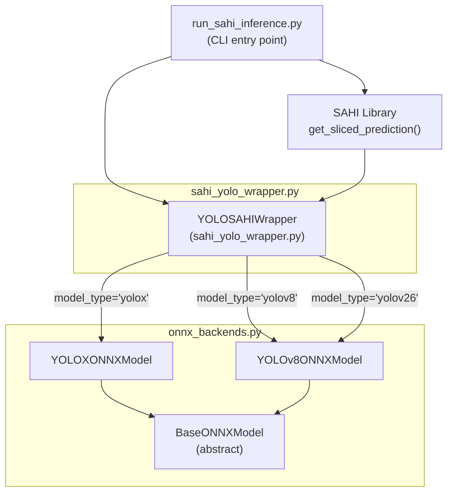
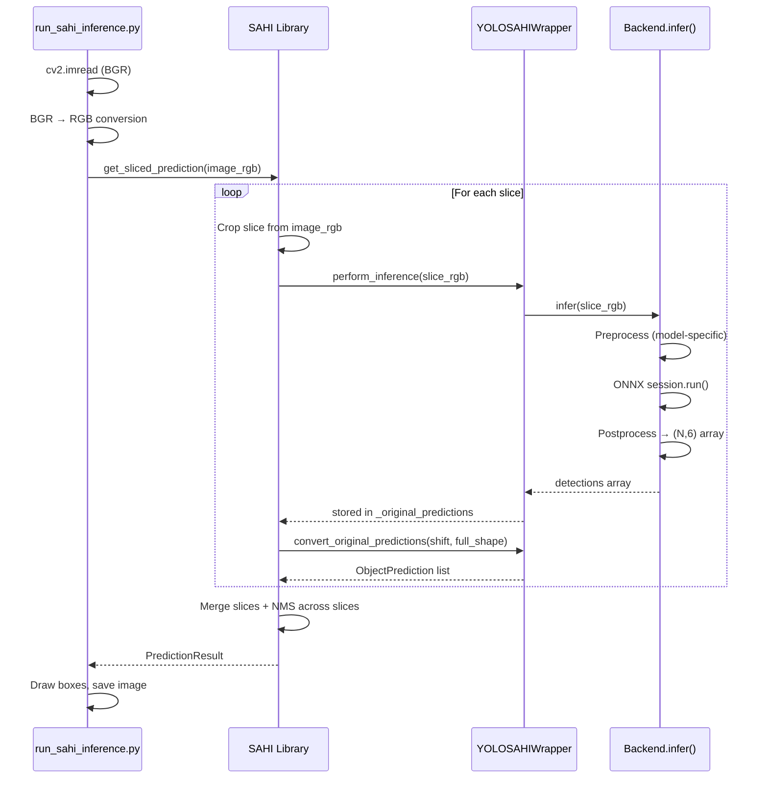

# Unified SAHI Wrapper — Detailed Walkthrough

## 1. Problem Statement

The original repo had **three separate inference workflows**:

| Model | Inference | SAHI support |
|---|---|---|
| YOLOX | [yolox_onnx_inference.py](file:///Users/adithyac/Code/SAHI_Wrapper/yolox_onnx_inference.py) (class) | ✅ via [sahi_yolox_onnx.py](file:///Users/adithyac/Code/SAHI_Wrapper/sahi_yolox_onnx.py) |
| YOLOv8 | [inference_yolo8_onnx.py](file:///Users/adithyac/Code/SAHI_Wrapper/inference_yolo8_onnx.py) (script) | ❌ |
| YOLOv26 | [inference_yolo26_onnx.py](file:///Users/adithyac/Code/SAHI_Wrapper/inference_yolo26_onnx.py) (script) | ❌ |

**Goal**: One SAHI wrapper that works with all three models.

---

## 2. Architecture Overview



**Key design**: All backends return the **same format** — `(N, 6)` numpy array with columns `[x1, y1, x2, y2, score, class_id]` — so the SAHI wrapper doesn't need any model-specific logic.

---

## 3. Files Created

### 3.1 [onnx_backends.py](file:///Users/adithyac/Code/SAHI_Wrapper/onnx_backends.py) — Inference Backends

This file contains three classes and a registry dict:

#### `BaseONNXModel` (abstract, lines 22–38)
- Loads the ONNX model via `onnxruntime.InferenceSession`
- Stores `img_size`, `conf_threshold`, `session`, `input_name`
- Defines the abstract contract: `infer(image_rgb) → ndarray(N,6) | None`

#### `YOLOXONNXModel` (lines 44–182)

Ported from the existing [yolox_onnx_inference.py](file:///Users/adithyac/Code/SAHI_Wrapper/yolox_onnx_inference.py).

**Preprocessing** ([_preprocess](file:///Users/adithyac/Code/SAHI_Wrapper/onnx_backends.py#L59-L76)):
1. RGB → BGR (YOLOX models are trained on BGR)
2. Resize maintaining aspect ratio, pad to `img_size × img_size` with value 114
3. Transpose HWC → CHW, cast to float32 (**no** /255 normalization)

**Postprocessing** ([_postprocess](file:///Users/adithyac/Code/SAHI_Wrapper/onnx_backends.py#L142-L176)):
1. Build anchor grids for strides [8, 16, 32]
2. Decode: `(output + grid) × stride` for center xy, `exp(output) × stride` for wh
3. Convert `cxcywh → xyxy`, divide by resize ratio
4. Multiply `obj_confidence × class_confidence` to get per-class scores
5. Run class-agnostic multiclass NMS

**NMS** ([_nms](file:///Users/adithyac/Code/SAHI_Wrapper/onnx_backends.py#L80-L98), [_multiclass_nms_class_agnostic](file:///Users/adithyac/Code/SAHI_Wrapper/onnx_backends.py#L100-L114), [_multiclass_nms_class_aware](file:///Users/adithyac/Code/SAHI_Wrapper/onnx_backends.py#L116-L135)):
- Pure numpy implementation (no torch dependency)
- Supports both class-agnostic and class-aware modes

#### `YOLOv8ONNXModel` (lines 188–267)

Ported from [inference_yolo8_onnx.py](file:///Users/adithyac/Code/SAHI_Wrapper/inference_yolo8_onnx.py). **Also used for YOLOv26** since their ONNX export format and preprocessing are identical.

**Preprocessing** ([_preprocess](file:///Users/adithyac/Code/SAHI_Wrapper/onnx_backends.py#L220-L226)):
1. Letterbox: resize maintaining aspect ratio with **centered** padding (top/bottom/left/right)
2. Normalize `/255.0`
3. Transpose HWC → CHW, expand batch dim

**Postprocessing** (inside [infer](file:///Users/adithyac/Code/SAHI_Wrapper/onnx_backends.py#L243-L267)):
- The ONNX model already outputs decoded `(N, 6)` predictions — no grid decode needed
- Apply confidence threshold filter
- Scale boxes back to original coordinates (undo letterbox padding + ratio)

#### `MODEL_REGISTRY` (lines 273–277)

```python
MODEL_REGISTRY = {
    "yolox":  YOLOXONNXModel,
    "yolov8": YOLOv8ONNXModel,
    "yolov26": YOLOv8ONNXModel,  # identical pipeline
}
```

---

### 3.2 [sahi_yolo_wrapper.py](file:///Users/adithyac/Code/SAHI_Wrapper/sahi_yolo_wrapper.py) — Unified SAHI Wrapper

A single `YOLOSAHIWrapper` class that extends SAHI's `DetectionModel`.

**Constructor** (lines 37–63):
- Takes `model_type` (`"yolox"`, `"yolov8"`, or `"yolov26"`) to select the backend
- Takes `category_mapping` dict (string keys → class names) for SAHI's ObjectPrediction
- Validates `model_type` against `MODEL_REGISTRY`

**[load_model](file:///Users/adithyac/Code/SAHI_Wrapper/sahi_yolo_wrapper.py#L67-L74)**: Instantiates the correct backend class with `model_path`, `img_size`, `conf_threshold`.

**[perform_inference](file:///Users/adithyac/Code/SAHI_Wrapper/sahi_yolo_wrapper.py#L91-L97)**: Called by SAHI once per image slice. Delegates to `self.model.infer(image)` and stores the result.

**[_create_object_prediction_list_from_original_predictions](file:///Users/adithyac/Code/SAHI_Wrapper/sahi_yolo_wrapper.py#L99-L138)**: Converts the uniform `(N, 6)` array into SAHI `ObjectPrediction` objects, applying `shift_amount` (for stitching slices back) and `full_shape` (for clipping).

---

### 3.3 [run_sahi_inference.py](file:///Users/adithyac/Code/SAHI_Wrapper/run_sahi_inference.py) — CLI Demo Script

**Class mappings** (lines 32–64): Pre-configured for the cell detection task:
- YOLOv8: `{0: plt, 1: rbc, 2: retic, 3: wbc, 4: nrbc}`
- YOLOX/YOLOv26: `{0: rbc, 1: retic, 2: nrbc, 3: wbc, 4: plt}`

**Colour map** (lines 52–58): Keyed by class **name** so it works regardless of class ID ordering.

**Main loop** (lines 82–151):
1. Build `YOLOSAHIWrapper` with chosen `model_type`
2. For each image: optionally pre-scale, convert BGR→RGB, run `get_sliced_prediction`
3. Draw colour-coded bounding boxes on the original-scale image
4. Save annotated images to output directory

---

## 4. Data Flow Through SAHI



> [!IMPORTANT]
> **Color space convention**: SAHI receives and delivers **RGB** images. Each backend's `infer()` expects RGB. YOLOX internally converts RGB→BGR (the format it was trained on). YOLOv8/v26 keeps RGB as-is.

---

## 5. Key Differences Between Models

| Aspect | YOLOX | YOLOv8 / YOLOv26 |
|---|---|---|
| **Color space** | Converts RGB→BGR internally | Stays in RGB |
| **Resize strategy** | Top-left aligned padding | Centered letterbox padding |
| **Normalization** | None (raw uint8 → float32) | `/255.0` |
| **ONNX output** | Raw grid predictions (needs decode) | Already decoded `(N, 6)` |
| **Post-NMS** | Custom numpy NMS | Confidence filter only |
| **Box format out** | `[x1, y1, x2, y2, score, class_id]` | `[x1, y1, x2, y2, score, class_id]` |

---

## 6. Bug Found and Fixed: Color Space Mismatch

> [!WARNING]
> The initial implementation had a critical color space bug affecting YOLOv8/v26 detection quality.

**Symptom**: YOLOv8 outputs were visually wrong — detections in incorrect locations or missed entirely.

**Root cause**: 
- SAHI passes **RGB** slices to `perform_inference`
- `YOLOv8ONNXModel._preprocess` called `cv2.cvtColor(img, COLOR_BGR2RGB)` on the already-RGB input
- This double-flipped the channels: RGB → BGR
- The model received BGR instead of the expected RGB

**Fix**: Removed the `cvtColor` call since the input is already RGB from SAHI.

```diff
 def _preprocess(self, img_rgb: np.ndarray):
+    """Letterbox + normalize. Expects RGB input (SAHI convention)."""
     img_lb, ratio, dwdh = self._letterbox(img_rgb, self.img_size)
-    img_rgb = cv2.cvtColor(img_lb, cv2.COLOR_BGR2RGB)
-    img_norm = img_rgb / 255.0
+    img_norm = img_lb / 255.0
     img_chw = np.transpose(img_norm, (2, 0, 1))
```

---

## 7. API Reference

### `YOLOSAHIWrapper`

```python
from sahi_yolo_wrapper import YOLOSAHIWrapper

model = YOLOSAHIWrapper(
    model_path="best_yolov8.onnx",       # path to ONNX file
    confidence_threshold=0.25,            # min detection confidence
    category_mapping={"0": "plt", ...},   # str(class_id) → class_name
    model_type="yolov8",                  # "yolox" | "yolov8" | "yolov26"
    image_size=416,                       # model input size (slicing size)
    load_at_init=True,                    # load model immediately
)
```

### CLI

```bash
python run_sahi_inference.py \
    --model_path best_yolov8.onnx \
    --model_type yolov8 \
    --input_dir sample_10 \
    --output_dir sahi_output \
    --img_size 416 \
    --confidence 0.25 \
    --overlap 0.2 \
    --scale 1.0
```

| Flag | Default | Description |
|---|---|---|
| `--model_path` | required | Path to ONNX model file |
| `--model_type` | required | `yolox`, `yolov8`, or `yolov26` |
| `--input_dir` | required | Directory containing input images |
| `--output_dir` | `sahi_output` | Output directory for annotated images |
| `--img_size` | `416` | Slice size and model input size |
| `--confidence` | `0.25` | Minimum confidence threshold |
| `--overlap` | `0.2` | Overlap ratio between adjacent slices |
| `--scale` | `1.0` | Pre-scale factor (e.g. `0.5` to halve) |

---

## 8. Test Results

Both available models tested against `sample_10/` (14 images):

| Model | Command | Status | Speed | Output |
|---|---|---|---|---|
| **YOLOv8** | `--model_type yolov8 --model_path best_yolov8.onnx` | ✅ Pass | 0.08 s/img | `sahi_output_yolov8/` (14 images) |
| **YOLOv26** | `--model_type yolov26 --model_path best_yolov26.onnx` | ✅ Pass | 0.06 s/img | `sahi_output_yolov26/` (14 images) |
| **YOLOX** | Not tested (no `.onnx` in repo) | — | — | — |

Standalone backend patch-level sanity check (first 3 images):
- `00dfc9e4...patch_1_0.png`: **38** detections
- `0a42f906...patch_1_2.png`: **28** detections  
- `0b9187e6...patch_0_2.png`: **18** detections

---

## 9. Compatibility Note

> [!NOTE]
> **SAHI 0.11.19**: The `ObjectPrediction` constructor no longer accepts `bool_mask` (removed in favor of `segmentation`). Our wrapper uses the updated API. If you're on an older SAHI version that requires `bool_mask`, add it back to the constructor call in `sahi_yolo_wrapper.py` line 128.

---

## 10. Adding a New Model

To add a new YOLO variant (e.g., YOLOv9):

1. Create a new class in `onnx_backends.py` inheriting from `BaseONNXModel`
2. Implement `infer(image_rgb)` returning `(N, 6)` array `[x1, y1, x2, y2, score, class_id]`
3. Register it in `MODEL_REGISTRY`:
   ```python
   MODEL_REGISTRY["yolov9"] = YOLOv9ONNXModel
   ```
4. Add the class mapping and model type choice in `run_sahi_inference.py`
